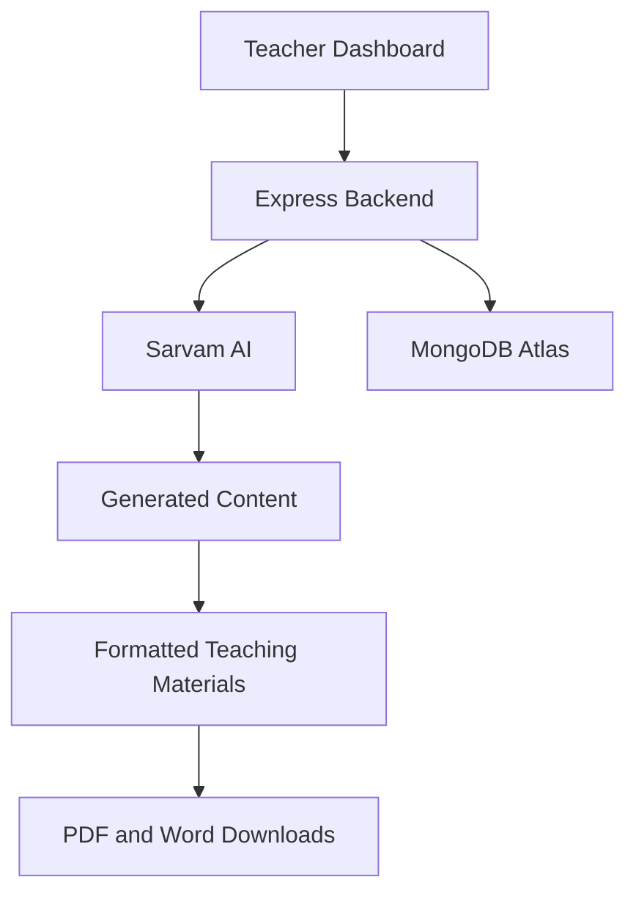

# 🎓 Sahayak AI — Your Classroom Companion

Sahayak is an AI-powered teaching assistant that helps teachers create lesson plans, relatable classroom examples, quizzes and interactive science visualizations, all from a single platform.

🔗 **Try it here:** [Live Product](https://sahayak-teacher-platform.vercel.app/)

Built as part of DES646 — AI/ML for Designers at IIT Kanpur.

---

## 💡 Why We Built Sahayak

While working on our course project, we surveyed 15 government primary school teachers to understand the challenges they face in their daily teaching.

Preparing lessons, designing assessments and finding engaging ways to explain difficult concepts takes considerable time. We wanted to build something that makes this process easier and allows teachers to spend more time interacting with their students.

This led us to build Sahayak.

---

##  What Can Sahayak Do?

### AI Lesson Plans
Enter a topic and select a grade to generate a structured lesson plan with explanations, examples, classroom activities and exercises.

### Localized Learning
Generate lessons using local examples and familiar situations that students can relate to.

### Quiz Generator
Create multiple-choice questions with correct answers to assess students' understanding of any topic.

### Interactive Science Lab
Explore scientific concepts through interactive visualizations. Adjust the frequency and amplitude of a travelling wave and observe the changes in real time.

### Download Teaching Materials
Download generated lesson plans and quizzes as PDF or editable Word documents for classroom use.

### Teacher Dashboard
Create an account and access all the teaching tools from a single dashboard.

---

## 🛠️ Technology Stack

| Component | Technology |
|---|---|
| Frontend | React, TypeScript, Vite, Tailwind CSS |
| Backend | Node.js, Express.js |
| Database | MongoDB Atlas |
| Artificial Intelligence | Sarvam AI |
| Authentication | JWT, bcrypt |
| Document Export | DOCX, html2pdf.js |
| Mathematical Rendering | KaTeX |
| Deployment | Vercel |
| Video Generation Module | Python, Manim |

---

## 🏗️ Project Architecture



---

## 📂 Folder Structure

```text
Sahayak/
├── sahayak-ai-educator/    # Frontend and teacher dashboard
├── sahayak-backend/        # Backend, authentication and AI
├── VideoGenerator/         # Scientific video generation module
├── api/                    # Vercel backend entry point
├── package.json
└── vercel.json             # Deployment configuration
```

---

## 🚀 Running the Project Locally

### Backend Setup

```bash
cd sahayak-backend
npm install
```

Create a `.env` file:

```env
PORT=5000
MONGO_URI=your_mongodb_connection_string
SARVAM_API_KEY=your_api_key
JWT_SECRET=your_jwt_secret
```

Start the backend:

```bash
npm run dev
```

### Frontend Setup

```bash
cd sahayak-ai-educator
npm install
```

Create a `.env.local` file:

```env
VITE_API_BASE_URL=http://localhost:5000/api
```

Start the frontend:

```bash
npm run dev
```

---

## Scientific Video Generation

The original project also includes a separate experimental video generation module built using Python, LLMs and Manim.

It converts scientific topics into teaching scripts and animated visualizations. This module can be explored independently in the `VideoGenerator` folder.

---

## What's Next?

- Expand the library of interactive science simulations.
- Support more Indian languages.
- Improve lesson personalization based on student learning levels.
- Introduce teacher feedback and performance analytics.

---

## 📄 Project Documentation

Developed by a five-member team as part of DES646 at IIT Kanpur.

- [Final Project Report](DES646_Sahayak_Ai_Final_Report.pdf)
- [Project Presentation](DES646%20PROJECT.pdf)

---

Made with ❤️ at IIT Kanpur.
